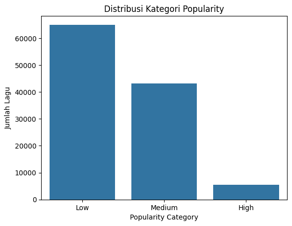
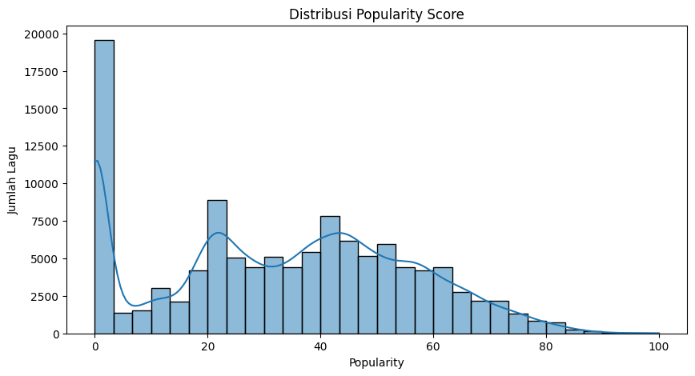
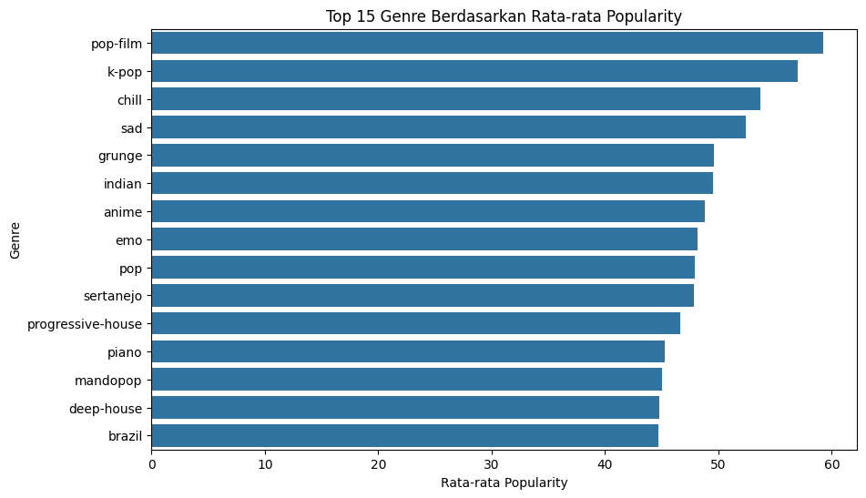
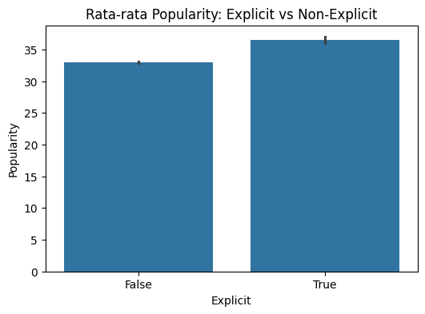
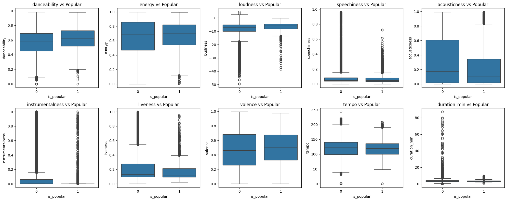
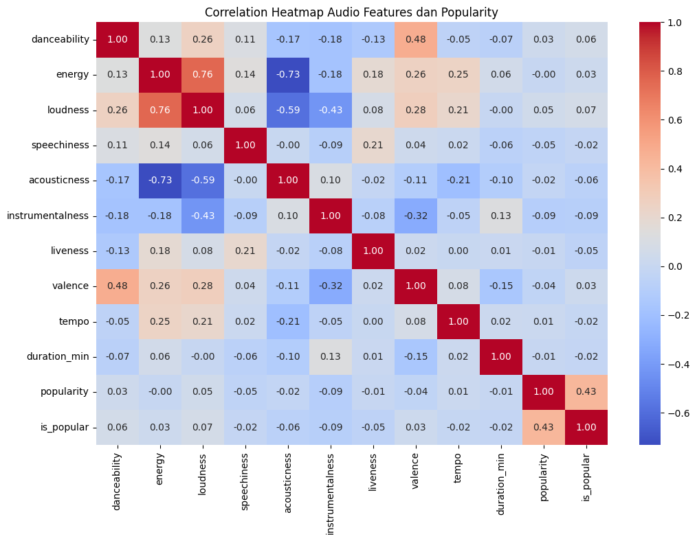
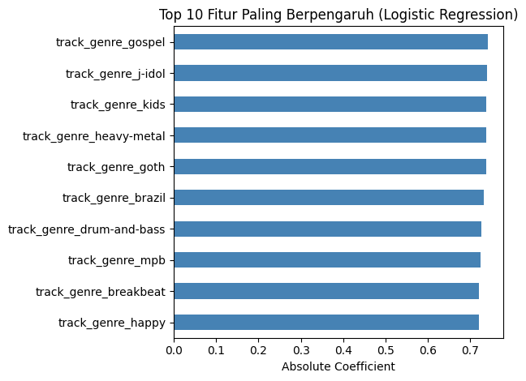
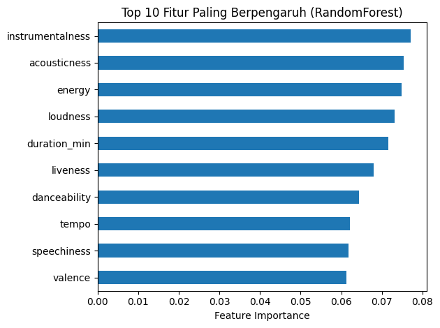
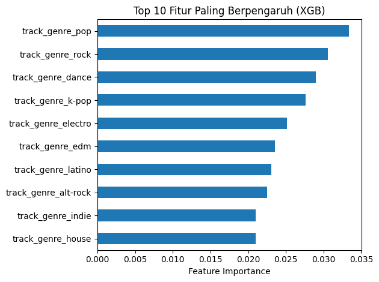

# 🎵 Spotify Music Trends Analysis

Membedah karakteristik audio dan genre lagu untuk merancang strategi playlist yang lebih tepat sasaran.

[](https://www.python.org/)
[](https://scikit-learn.org/)
[](https://xgboost.ai/)
[](https://public.tableau.com/)

**📊 Live Dashboard:** [Spotify Music Trends — Tableau Public](https://public.tableau.com/views/DashboardSpotifyMusicTrends/Dashboard1) · **📓 Notebook:** [Kaggle](https://www.kaggle.com/code/zx1700/da02-spotify)

---

## 📌 Ringkasan Eksekutif

| Pertanyaan | Jawaban |
|---|---|
| Seberapa langka lagu populer? | Hanya **4,8%** lagu mencapai popularity ≥ 70 |
| Genre apa yang paling kuat? | **pop-film (59,3)**, **k-pop (57,0)**, **chill (53,7)** |
| Fitur audio apa yang membedakan? | Loudness tinggi, acousticness & instrumentalness rendah |
| Seberapa besar pengaruhnya? | **Kecil** — fitur audio saja tidak cukup memprediksi popularitas |
| Lalu apa yang menentukan? | Faktor di luar data ini: artis, playlist placement, momentum viral, label |

> **Insight utama:** popularitas lagu adalah **outlier, bukan norma**. Distribusinya sangat miring — 57,2% lagu berada di kategori Low, dan hanya 4,8% masuk High. Artinya strategi playlist tidak bisa mengandalkan "lagu bagus akan populer sendiri"; popularitas perlu dipicu secara aktif.

---

## 🎯 Business Understanding

### Latar Belakang

Spotify adalah platform streaming dengan katalog ratusan ribu lagu. Bagi tim curation dan playlist, tantangan utamanya bukan menyediakan musik — tapi **memilih lagu mana yang layak didorong** ke pendengar yang tepat.

Popularity score (0–100) adalah sinyal permintaan yang tersedia terbuka. Jika karakteristik audio bisa memprediksi skor ini, tim curation punya cara cepat menyaring kandidat lagu sebelum playlist dirilis, tanpa harus menunggu data performa historis.

### Pertanyaan Bisnis

1. Bagaimana distribusi popularity lagu di Spotify?
2. Genre apa yang punya rata-rata popularity tertinggi?
3. Apakah lagu explicit lebih populer daripada non-explicit?
4. Fitur audio apa yang membedakan lagu populer dan tidak populer?
5. Fitur apa yang paling berpengaruh dalam memprediksi lagu populer?

### Tujuan

| # | Tujuan | Output |
|---|---|---|
| 1 | Memetakan distribusi popularitas | EDA + segmentasi Low/Medium/High |
| 2 | Mengidentifikasi genre unggulan | Ranking genre by average popularity |
| 3 | Menguji klaim umum soal lagu explicit | Perbandingan dengan sampel diseimbangkan |
| 4 | Menemukan pembeda audio | Korelasi + boxplot + feature importance |
| 5 | Menguji kelayakan prediksi | Perbandingan 3 model klasifikasi |

### Metrik Keberhasilan

- **Metrik bisnis:** performa playlist (skip rate rendah, save rate tinggi) — di luar cakupan proyek ini.
- **Metrik model:** **PR-AUC** dan **ROC-AUC**, bukan akurasi. Dengan kelas populer hanya 4,8%, akurasi tinggi bisa menyesatkan: model yang selalu menebak "tidak populer" sudah dapat ~95% akurasi tanpa belajar apa pun.

### Cakupan

**Termasuk:** EDA, analisis genre, perbandingan explicit, korelasi audio features, modeling baseline, feature importance, dashboard Tableau.
**Tidak termasuk:** data historis playlist, metrik engagement (skip/save), data artis dan label, analisis lirik, data demografi pendengar.

---

## 🗂️ Dataset

| Atribut | Keterangan |
|---|---|
| **Sumber** | [Kaggle — Spotify Tracks Dataset](https://www.kaggle.com/datasets/maharshipandya/-spotify-tracks-dataset) |
| **Ukuran awal** | ±114.000 baris |
| **Kolom** | 20 kolom |
| **Genre** | 114 genre |
| **Duplikat dihapus** | 450 baris |
| **Target** | `is_popular` (popularity ≥ 70) |

**Kelompok fitur:**

- **Identitas:** `track_id`, `artists`, `album_name`, `track_name` — **tidak dipakai modeling** (nilai unik terlalu banyak, mis. 31.000+ artis)
- **Audio features:** `danceability`, `energy`, `loudness`, `speechiness`, `acousticness`, `instrumentalness`, `liveness`, `valence`, `tempo`, `duration_min`
- **Musikal:** `key`, `mode`, `time_signature`
- **Konten:** `explicit`
- **Kategori:** `track_genre`
- **Target asal:** `popularity`

**Distribusi target:**

| Kategori | Rentang | Proporsi |
|---|---|---:|
| Low | 0–39 | **57,2%** |
| Medium | 40–69 | **37,9%** |
| High | ≥70 | **4,8%** |

> **Catatan:** angka proporsi di atas berasal dari analisis di notebook. Dataset mentahnya tidak disertakan di repo ini, sehingga angkanya tidak bisa direproduksi ulang tanpa mengunduh dari Kaggle.

---

## 🔬 Metodologi

```
Data Loading → EDA → Cleaning → Feature Engineering → Encoding → Split → Modeling → Evaluasi → Dashboard
```

1. **Data Loading** — ±114.000 baris × 20 kolom.
2. **EDA** — missing value, duplikasi, cardinality, distribusi popularity, ranking genre.
3. **Cleaning** — hapus `Unnamed: 0`, drop missing value, hapus 450 duplikat baris penuh.
4. **Feature Engineering** — `duration_ms` → `duration_min`; `popularity_category` (Low/Medium/High); `is_popular` (≥70).
5. **Encoding** — `track_genre` one-hot encoded dengan `drop_first=True`.
6. **Split** — 80:20 dengan **`stratify=y`**, penting karena kelas populer hanya 4,8%.
7. **Scaling** — `StandardScaler` di-*fit* pada data latih saja, lalu diterapkan ke data uji. Urutan benar, tidak ada leakage.
8. **Modeling** — tiga model dibandingkan: Logistic Regression (`class_weight='balanced'`), Random Forest, XGBoost (`scale_pos_weight`).
9. **Evaluasi** — classification report, confusion matrix, **ROC-AUC**, **PR-AUC**, kurva ROC dan PR.

**Kenapa tiga model?** Logistic Regression jadi baseline yang mudah dijelaskan. Random Forest dan XGBoost menguji apakah interaksi non-linear menambah nilai. Perbandingannya justru mengungkap hal penting — lihat [Hasil Model](#-hasil-model).

---

## 📊 Temuan Utama (EDA)

### 1. Popularitas adalah kejadian langka, bukan kondisi normal

Hanya **4,8%** lagu masuk kategori High (popularity ≥ 70). Distribusinya sangat miring ke kiri — mayoritas lagu menumpuk di skor rendah. Ini berarti **memilih lagu hit dari katalog adalah masalah deteksi outlier**, bukan prediksi rata-rata.

| Kategori | Proporsi |
|---|---:|
| Low (0–39) | 57,2% |
| Medium (40–69) | 37,9% |
| High (≥70) | 4,8% |

| Distribusi Kategori | Distribusi Skor |
|---|---|
|  |  |

### 2. Genre: pop-film dan k-pop memimpin

| Rank | Genre | Rata-rata Popularity |
|---:|---|---:|
| 1 | pop-film | **59,3** |
| 2 | k-pop | **57,0** |
| 3 | chill | **53,7** |
| 4 | sad | **52,4** |
| 5 | grunge | **49,6** |

pop-film unggul karena terikat pada film yang sudah punya audiens besar — popularitasnya "menumpang" pada distribusi film, bukan semata kualitas audio.



### 3. Explicit vs non-explicit: sedikit lebih tinggi, tapi bukan faktor utama

Perbandingan awal berisiko bias karena jumlah lagu explicit jauh lebih sedikit. Notebook mengatasinya dengan **menyeimbangkan ukuran sampel** (sampling non-explicit sebesar jumlah explicit) sebelum membandingkan.

Hasilnya: lagu explicit punya rata-rata dan median popularity **sedikit lebih tinggi**, tetapi selisihnya kecil. Kesimpulan yang jujur: ada indikasi, **bukan bukti kuat**, dan explicit bukan penentu popularitas.



### 4. Fitur audio: arahnya jelas, besarannya kecil

| Fitur Audio | Arah Korelasi |
|---|---|
| `loudness` | Positif (terkuat di antara audio features) |
| `danceability` | Positif lemah |
| `energy` | Positif lemah |
| `acousticness` | Negatif |
| `instrumentalness` | Negatif |
| `tempo`, `valence` | Nyaris tidak berpengaruh |

**Cara membaca yang benar:** loudness adalah korelasi positif **terkuat di antara fitur audio**, tapi kekuatannya tetap **lemah secara absolut**. Ini perbedaan penting — "terkuat" bukan berarti "kuat". Profil lagu populer memang cenderung lebih keras, lebih danceable, dan kurang akustik, tetapi karakteristik audio saja tidak menjelaskan sebagian besar variasi popularitas.

| Boxplot Perbandingan | Heatmap Korelasi |
|---|---|
|  |  |

---

## 🤖 Hasil Model

Tiga model dilatih dan dibandingkan pada threshold default 0,5.

**Temuan utama dari perbandingan:**

| Model | Perilaku pada threshold 0,5 | Kemampuan ranking |
|---|---|---|
| **Logistic Regression** | Paling banyak menangkap lagu populer (recall tertinggi) | Menengah |
| **Random Forest** | Terlalu konservatif — jarang menebak "populer" (recall rendah) | **Terbaik (ROC-AUC & PR-AUC tertinggi)** |
| **XGBoost** | Cukup seimbang | Menengah |

> **Ini nuansa yang sering terlewat:** Random Forest punya **kemampuan pemisahan terbaik** (ROC-AUC dan PR-AUC tertinggi), tapi pada threshold 0,5 ia terlalu pelit menebak "populer". Artinya model terbaik secara statistik bisa tampak buruk jika threshold-nya tidak disesuaikan. Random Forest berpotensi jadi pilihan terbaik **asalkan threshold diturunkan** sesuai kapasitas kurasi tim.

**Catatan transparansi:** nilai persis ROC-AUC, PR-AUC, precision, dan recall per model **tidak tersimpan** di notebook (output sel tidak di-*commit*). Angka spesifik sengaja tidak dicantumkan di sini daripada mencantumkan yang tidak bisa diverifikasi. Untuk mendapatkannya, jalankan ulang notebook dengan dataset Kaggle.

**Feature importance per model:**

| Logistic Regression | Random Forest | XGBoost |
|---|---|---|
|  |  |  |

---

## ⚠️ Keterbatasan & Asumsi

1. **Metrik model tidak tersimpan.** Hanya arah dan perbandingan relatif yang terdokumentasi. Nilai ROC-AUC/PR-AUC per model perlu direproduksi ulang.
2. **Dataset tidak disertakan.** Angka EDA berasal dari notebook dan tidak bisa diverifikasi ulang tanpa mengunduh dari Kaggle.
3. **Satu lagu bisa muncul di banyak genre.** Dataset ini menempatkan track yang sama di beberapa genre. Yang dihapus hanya 450 duplikat baris **penuh**, sehingga rata-rata per genre masih bisa terpengaruh oleh seberapa banyak genre yang menandai sebuah lagu.
4. **Popularity bukan ukuran kualitas.** Popularity adalah metrik permintaan yang dipengaruhi playlist placement, momentum viral, dan promosi label — bukan cermin kualitas musikal.
5. **Fitur audio menjelaskan sedikit.** Korelasi terkuat pun lemah. Model tidak akan mampu memprediksi hit hanya dari karakteristik audio, dan sebaiknya tidak dipakai untuk itu.
6. **`is_popular` adalah batas arbitrer.** Ambang ≥70 adalah pilihan analis; ambang 60 atau 80 akan mengubah proporsi kelas dan hasil model.
7. **Tanpa validasi temporal.** Data tidak dipisah berdasarkan waktu, jadi belum diketahui apakah pola ini stabil antar periode.
8. **Korelasi bukan kausalitas.** Loudness berkorelasi dengan popularitas, tapi menaikkan volume lagu tidak akan membuatnya populer. Loudness kemungkinan hanya proxy dari genre dan era produksi.

---

## 💡 Rekomendasi Action Items

Disusun berdasarkan **dampak × kemudahan eksekusi**.

### Prioritas 1 — Playlist "Hits" berbasis profil audio

- Susun kriteria penyaringan awal: **loudness tinggi, danceability tinggi, acousticness & instrumentalness rendah**.
- Gunakan kriteria ini sebagai **filter kandidat**, bukan penentu akhir — perannya menyaring katalog besar menjadi daftar pendek yang layak didengar tim kurator.
- Dokumentasikan kriteria agar konsisten antar kurator dan bisa dievaluasi ulang tiap kuartal.

### Prioritas 2 — Strategi genre

- **pop-film, k-pop, chill** layak jadi genre andalan playlist utama — rata-rata popularity-nya tertinggi dan audiensnya sudah terbentuk.
- **pop-film** punya keunggulan struktural: audiens film sudah ada sebelum lagunya dirilis. Manfaatkan momen rilis film untuk playlist tematik.
- Hindari menyimpulkan genre "buruk" dari rata-rata rendah — bisa jadi jumlah sampelnya kecil atau lagunya baru.

### Prioritas 3 — Playlist berbasis mood

- Manfaatkan `valence` (keceriaan), `energy`, dan `tempo` untuk playlist kontekstual: workout, fokus kerja, perjalanan malam.
- Fitur-fitur ini **tidak** memprediksi popularitas, tapi sangat berguna untuk **kecocokan konteks** — tujuan yang berbeda dari prediksi hit.
- Ini justru pemanfaatan paling jujur dari data audio: untuk mencocokkan suasana, bukan meramal kesuksesan.

### Prioritas 4 — Discovery playlist untuk artis baru

- Gunakan model sebagai **alat bantu ranking**, bukan keputusan otomatis. Turunkan threshold agar recall tinggi — lebih baik meninjau lebih banyak kandidat daripada melewatkan lagu potensial.
- Prioritaskan lagu dari artis dengan katalog kecil yang profil audionya mirip lagu populer.
- Ukur hasilnya: apakah lagu yang didorong lewat discovery benar-benar naik popularity-nya? Ini sekaligus menguji apakah model punya nilai nyata.

### Prioritas 5 — Bangun data yang lebih kuat

- Tambahkan **metrik engagement** (skip rate, save rate, repeat play) — jauh lebih dekat ke nilai bisnis daripada popularity score.
- Tambahkan **data artis** (jumlah follower, riwayat rilis) dan **playlist placement**, karena faktor-faktor inilah yang kemungkinan menjelaskan sebagian besar popularitas.
- Simpan output evaluasi model di notebook agar hasilnya bisa diaudit.

### KPI yang Disarankan

| KPI | Baseline | Target |
|---|---|---|
| Proporsi lagu High popularity di playlist kurasi | 4,8% (populasi) | > 15% |
| Skip rate playlist baru | — | Turun 10% vs playlist existing |
| Save rate lagu dari discovery playlist | — | > 5% |
| Waktu kurasi per playlist | — | Turun 30% dengan filter otomatis |

---

## 📈 Dashboard (Tableau)

**🔗 [Buka dashboard](https://public.tableau.com/views/DashboardSpotifyMusicTrends/Dashboard1)**

Dashboard menampilkan distribusi popularitas, performa genre, dan profil audio lagu populer.

<details>
<summary>Embed code (Tableau Public)</summary>

<div class='tableauPlaceholder' id='viz1779797548379' style='position: relative'><noscript><a href='#'></a></noscript><object class='tableauViz'  style='display:none;'><param name='host_url' value='https%3A%2F%2Fpublic.tableau.com%2F' /> <param name='embed_code_version' value='3' /> <param name='site_root' value='' /><param name='name' value='DashboardSpotifyMusicTrends&#47;Dashboard1' /><param name='tabs' value='no' /><param name='toolbar' value='yes' /><param name='static_image' value='https:&#47;&#47;public.tableau.com&#47;static&#47;images&#47;Da&#47;DashboardSpotifyMusicTrends&#47;Dashboard1&#47;1.png' /> <param name='animate_transition' value='yes' /><param name='display_static_image' value='yes' /><param name='display_spinner' value='yes' /><param name='display_overlay' value='yes' /><param name='display_count' value='yes' /><param name='language' value='en-US' /></object></div>

</details>

---

## 🚀 Cara Menjalankan

### 1. Prasyarat

- Python **3.10+**

### 2. Install dependensi

```bash
pip install -r requirements.txt
```

### 3. Siapkan dataset

Unduh [Spotify Tracks Dataset](https://www.kaggle.com/datasets/maharshipandya/-spotify-tracks-dataset) dari Kaggle, lalu sesuaikan path pada sel `read_csv` di notebook (default mengarah ke `/kaggle/input`).

### 4. Jalankan analisis

```bash
jupyter notebook da02-spotify-music-trends.ipynb
```

---

## 🗂️ Struktur Proyek

```
spotify-music-trends-analysis/
│
├── da02-spotify-music-trends.ipynb    # EDA, modeling, evaluasi
├── README.md
├── requirements.txt
├── .gitignore
│
├── screenshots/                       # Grafik analisis
│   ├── distribusi_kategori_popularity.png
│   ├── distribusi_popularity_score.png
│   ├── top_15_genre_berdasarkan_rata_rata_popularity.png
│   ├── rata_rata_popularity_explicit_vs_non_explicit.png
│   ├── chart_05.png
│   ├── correlation_heatmap_audio_features_dan_popularity.png
│   ├── top_10_fitur_paling_berpengaruh_logistic_regression.png
│   ├── top_10_fitur_paling_berpengaruh_randomforest.png
│   └── top_10_fitur_paling_berpengaruh_xgb.png
│
└── .github/workflows/sync-kaggle.yml  # Otomasi sinkronisasi Kaggle
```

---

## 🛠️ Tech Stack

| Kategori | Tools |
|---|---|
| Bahasa | Python 3.10+ |
| Analisis data | pandas, NumPy |
| Machine learning | scikit-learn, XGBoost |
| Visualisasi | Matplotlib, Seaborn |
| Business intelligence | Tableau Public |
| Environment | Jupyter / Kaggle Notebook |

---

## 👤 Author

**Zulfahmi M. Ardianto**
Laskar ID: A548YBM523

*Project ini merupakan bagian dari portfolio Data Analyst.*
